# 深易刷新手图文使用教程

适用 Windows 10／11 x64 和 Mac（Intel／Apple 芯片）。先准备 Google Chrome、UOOC 账号和解题服务 API Key。

截图以 Windows 为例，Mac 按文中标注操作，其余步骤相同。部分旧版截图显示 szu-uooc，与深易刷是同一程序。

## 1 下载程序

打开 <a href="https://github.com/zcx28/szu-uooc/releases/latest">深易刷下载页</a>，点 <b>ShenYiShua-Windows.zip</b>。Windows、Mac 都下载同一个 ZIP。

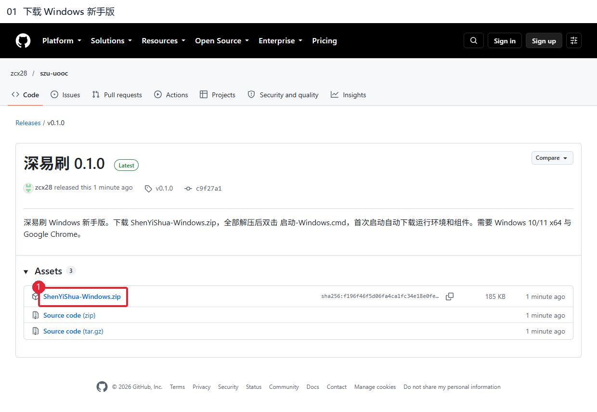

## 2 解压并启动

<b>Windows：</b>右键 ZIP → <b>全部解压</b>，打开解压后的文件夹，双击 <b>启动-Windows.cmd</b>。 <b>Mac：</b>双击 ZIP 解压，打开解压后的文件夹，双击 <b>启动-Mac.command</b>。 Mac 若提示没有执行权限：打开终端，输入 <code>chmod +x </code>（末尾留一个空格），拖入启动文件并按回车，再双击启动。

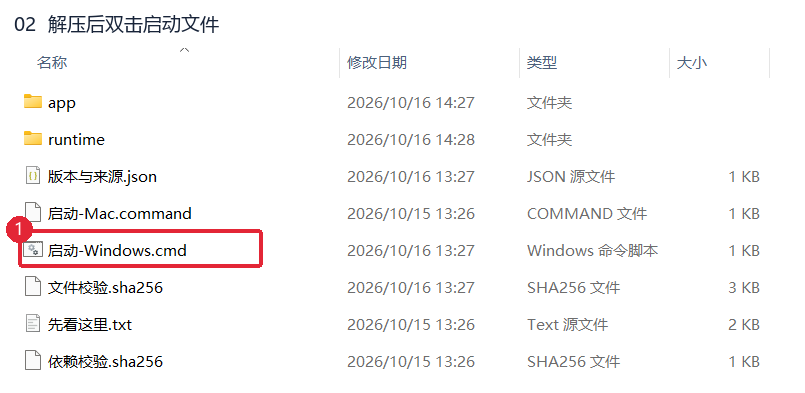

## 3 等待组件准备

保持联网，等待自动下载并打开控制台。已有组件会直接跳过；若提示失败，检查网络后重试。

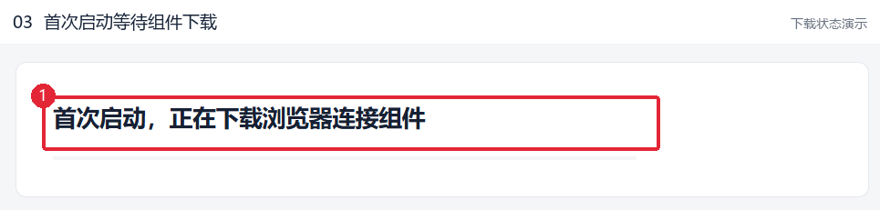

## 4 打开课程网站

在控制台点 <b>打开 UOOC</b>。

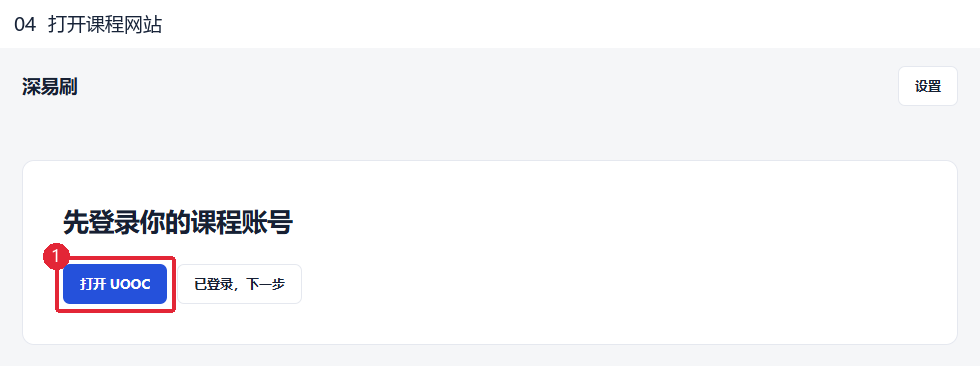

## 5 登录账号

输入你自己的课程账号和密码，按网站提示<b>手动完成验证</b>，再点 <b>登录</b>。

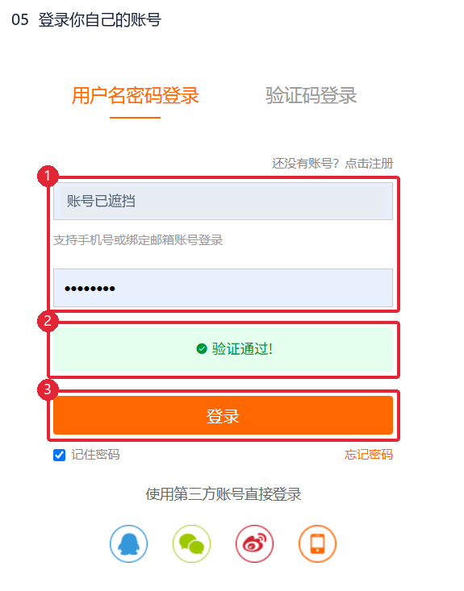

## 6 返回控制台

登录成功后，切回深易刷，点 <b>已登录，下一步</b>。

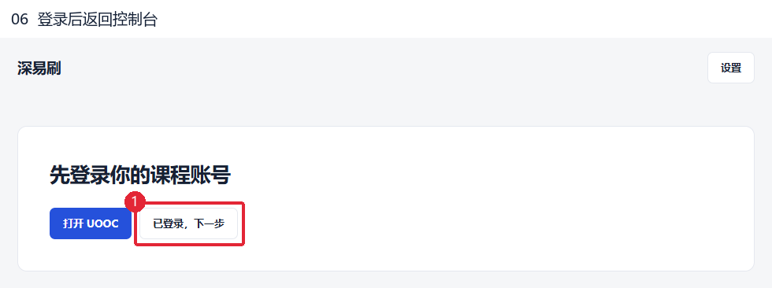

## 7 打开调试页

点 <b>复制调试页地址</b>，切到 Google Chrome。 <b>Windows：</b>按 <b>Ctrl＋L</b> 选中地址栏，按 <b>Ctrl＋V</b> 粘贴，再按回车。 <b>Mac：</b>按 <b>⌘＋L</b> 选中地址栏，按 <b>⌘＋V</b> 粘贴，再按回车。 地址：<code>chrome://inspect/#remote-debugging</code>

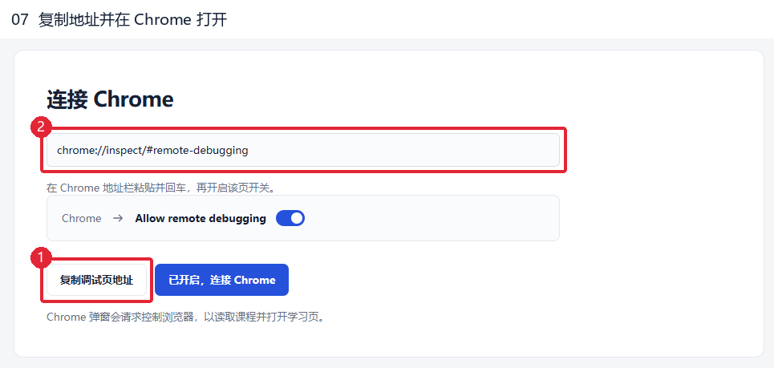

## 8 勾选远程调试

勾选 <b>Allow remote debugging</b>，勾选后应如图。此权限可控制浏览器，只连接你信任的本机程序。

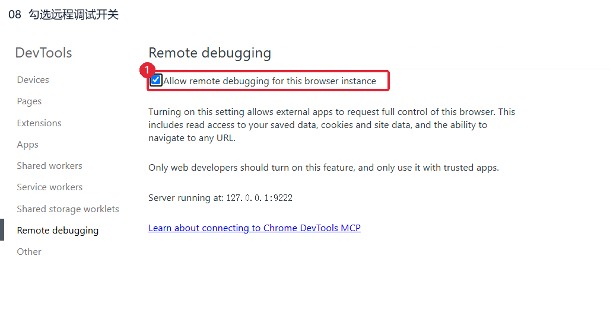

## 9 连接 Chrome

切回深易刷，点 <b>已开启，连接 Chrome</b>。

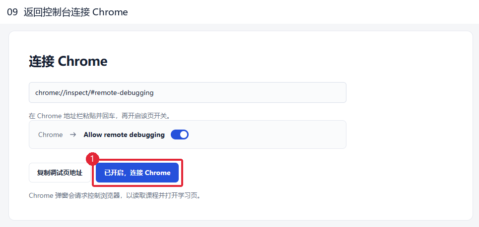

## 10 允许本次连接

在 Chrome 弹窗点 <b>允许</b>。程序会自动读取课程，等待课程列表出现。

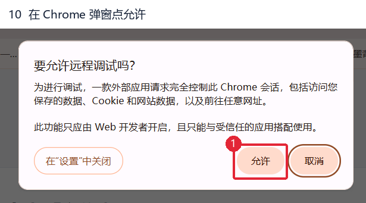

## 11 打开解题服务

点右上角 <b>设置</b> → <b>解题服务</b>。

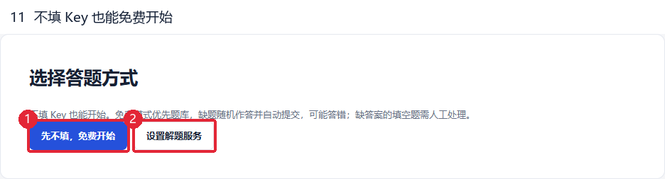

## 12 填写 Key 并核对设置

粘贴从解题服务商取得的 <b>API Key</b>，展开 <b>高级设置</b>。没有 Key 时，先向服务商获取。

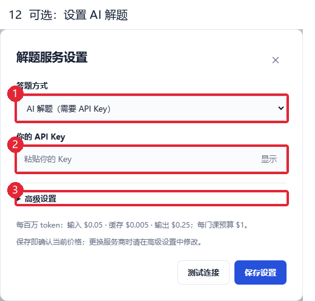

按服务商信息核对<b>接口、模型、实际价格和预算</b>。点 <b>测试连接</b>，成功后点 <b>保存设置</b>。图中价格仅是程序默认值。

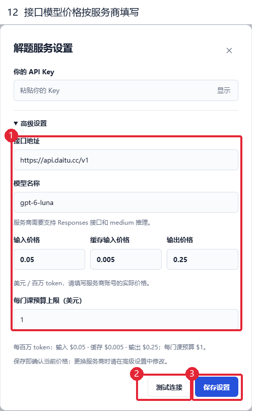

## 13 开始一门课程

找到要学习的课程，点旁边的 <b>开始</b>，等待课程页面打开。一次只运行一门；完成后再手动开始下一门。

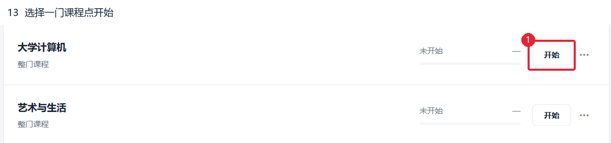

## 14 结束使用

临时停下可点 <b>暂停</b>，回来点 <b>继续</b>；换课先 <b>停止</b>。完全结束时点 <b>设置 → 退出程序</b>。只关网页，程序仍会运行。

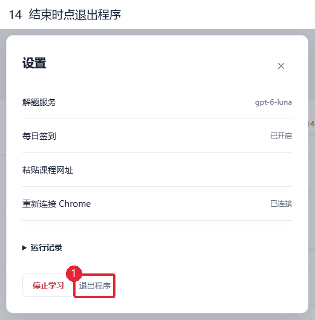

## 课程没有读出来时

先点 <b>刷新课程</b>。仍没有课程，点 <b>粘贴网址</b>。

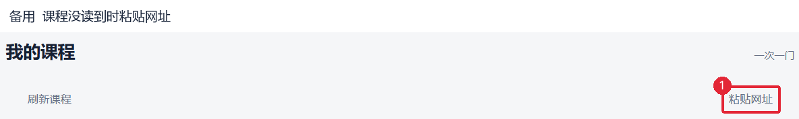

在 UOOC 打开课程并<b>进入学习页</b>，复制地址栏完整网址（含 <b>#</b> 后面的内容）。粘贴到输入框，一行一门，点 <b>加入全部课程</b>。

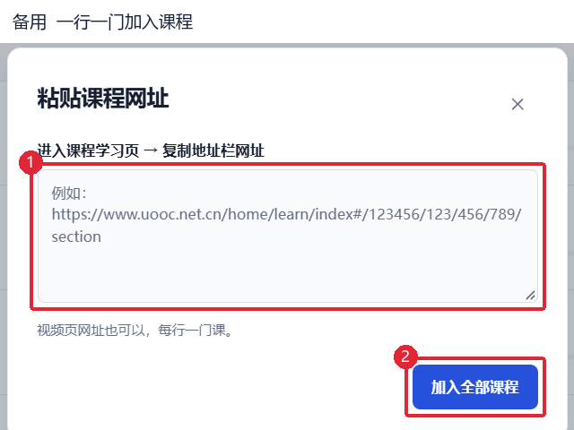

## 可选 每天自动签到

在 Chrome 安装 <a href="https://www.tampermonkey.net/">Tampermonkey 篡改猴</a>。回深易刷，点 <b>设置 → 每日签到</b>。

选择已登录 UOOC 的 <b>Chrome 资料</b>，点 <b>测试打开，核对账号</b>，确认打开的是你自己的账号。

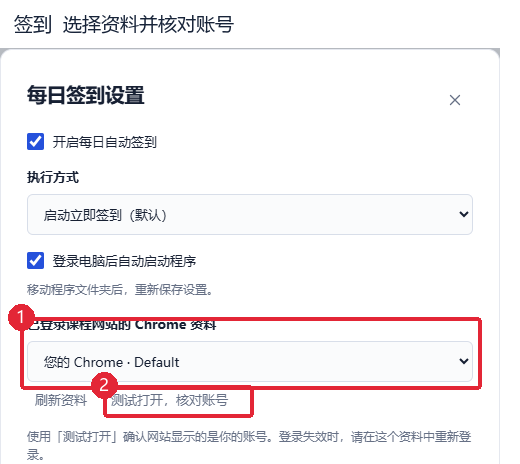

点 <b>安装／更新签到兼容脚本</b>，在篡改猴页面点 <b>安装</b>。停用旧版同名自动学习脚本，回控制台勾选 <b>已更新此脚本</b>。

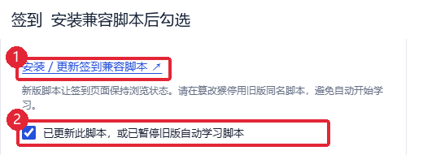

勾选 <b>开启每日自动签到</b> 和 <b>登录电脑后自动启动程序</b>；执行方式保持 <b>启动立即签到</b>。

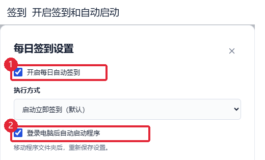

勾选需要签到的课程，点 <b>保存签到设置</b>。之后电脑开机登录并联网，程序会按设置打开课程页面；签到结果到 UOOC 核对。

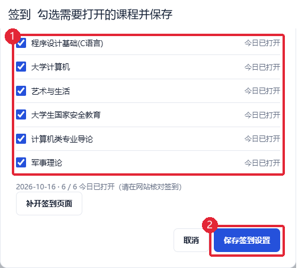

## 遇到这些提示时

<b>去验证：</b>切到课程窗口手动处理，验证通过后程序会自动继续。 <b>连接失败：</b>检查 Chrome 调试开关，再回控制台重新连接并允许。 <b>以后使用：</b>再次双击同一个启动文件，按页面提示连接 Chrome，再选课开始。
